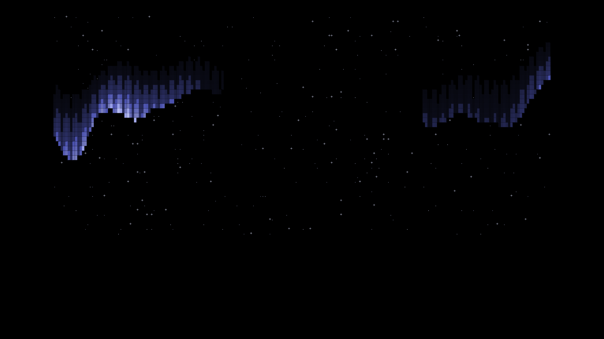
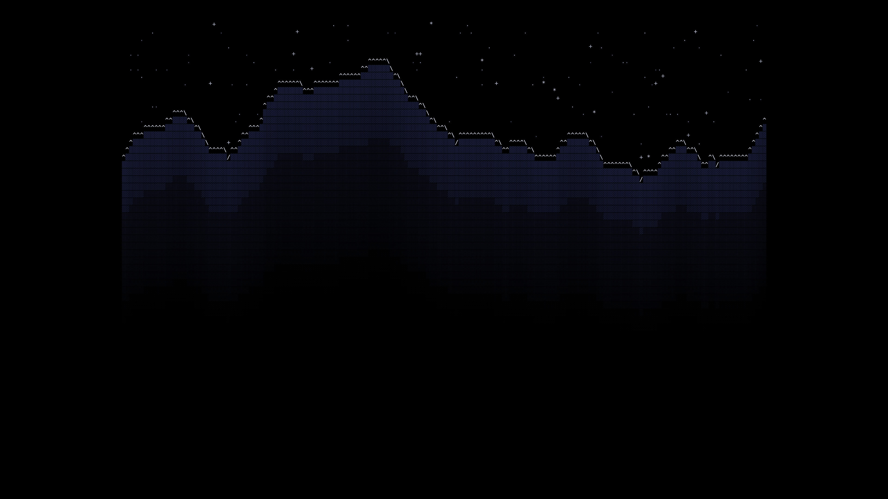

# Omarchy Kaamos Theme

**Kaamos** — Finnish for *polar night* — a pure-black theme for DHH's
[Omarchy](https://omarchy.org), an opinionated Arch Linux setup, made for the
inky blacks an OLED monitor craves and lit by a cold, aurora-blue accent.

## Palette

- **Background** — pure black `#000000`
- **Accent** — `#4F5BD5`, a dark royal blue that leans almost purple: cold and
  frosty, but still blue, lit like an aurora

## Preview


## Wallpapers

Every wallpaper is pure black with cool-white ASCII art, so the OLED stays
inky and the light stays where you put it. The default wallpaper is pure black.

The shortcut for switching wallpapers is <kbd>Ctrl</kbd>+<kbd>Super</kbd>+<kbd>Space</kbd>

<table>
  <tr>
    <td>Kaamos Black</td>
    <td>Aurora</td>
    <td>Polar Ridge</td>
    <td>North Star</td>
  </tr>
  <tr>
    <td></td>
    <td></td>
    <td></td>
    <td></td>
  </tr>
</table>

## Screensaver

This theme ships the arctic arch `screensaver.txt`. Omarchy branding is global
rather than per-theme, so apply it once, by hand:

```bash
cp screensaver.txt ~/.config/omarchy/branding/screensaver.txt
omarchy-launch-screensaver force    # preview it
```

Use `omarchy branding screensaver reset` to restore the stock wordmark.

## Installation

```bash
omarchy theme install https://github.com/yourname/omarchy-kaamos-theme.git
```

## Usage

Press <kbd>Ctrl</kbd>+<kbd>Shift</kbd>+<kbd>Super</kbd>+<kbd>Space</kbd>,
select "Kaamos", and everything refreshes automatically.
